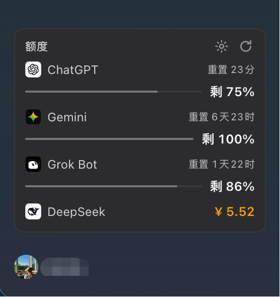

# 额度卡片 · dsh-quota-card



在 DeepSeek Harness 侧栏底部、登录名上方显示四个服务的额度与余额：

| Provider | 展示内容 | 数据来源 | 需要 |
|---|---|---|---|
| **ChatGPT** | 每周剩余 % + 重置倒计时 | `chatgpt.com/backend-api/wham/usage` | `~/.codex/auth.json`（运行过 `codex login`） |
| **Gemini** | 每周 / 5 小时剩余 % + 重置倒计时 | Google Cloud Code `retrieveUserQuotaSummary` | Antigravity 登录令牌 `~/.gemini/antigravity-cli/antigravity-oauth-token` |
| **Grok Bot** | 每周剩余 % + 重置倒计时 | Cursor `GetSandUsageStatus` | Cursor 用户 API Key：`CURSOR_API_KEY`（`~/.dsh/.env` 或环境变量） |
| **DeepSeek** | 账户余额（¥） | DSH 已登录账号服务 `deepseekAccount.getBalance()` | 在 DSH 内登录 DeepSeek 账号 |

## 交互

- **刷新**：默认 60 秒，页面隐藏时暂停；右上角 ↻ 立即刷新。
- **倒计时**：每秒本地走表，来自各家真实重置时间；悬停行可看到全部窗口（如 Gemini 的每周 + 5 小时）。
- **颜色**：剩余 ≤ 30% 变黄、≤ 10% 变红（可调）；DeepSeek 余额默认 ≤ ¥10 变黄、≤ ¥3 变红。
- **齿轮设置**（弹层，立即生效）：
  - 显示开关：关闭的 provider 不再请求；
  - 刷新间隔：30 / 60 / 120 / 300 秒；
  - 告警阈值：百分比与余额金额；
  - HTTP 代理：全局 + 每个 provider 覆盖，留空 = 直连（例如 `http://127.0.0.1:7890`）；
  - 恢复默认。

设置保存在浏览器 `localStorage` 的 `dsh-quota-card:settings`，不上传；代理 URL 只随取数请求发给本机 Host。

## 安全与隐私

- API Key、OAuth 令牌只在 **Host 进程**读取和使用，**不进入浏览器**；
- ChatGPT / Antigravity 的令牌只读，不写回登录文件；Grok Bot 使用 Cursor Key 换取短期访问令牌；
- 所有请求有 15 秒超时与错误脱敏；未知或失败显示「—」而不是 0。

## 已知限制

- ChatGPT、Grok Bot、Gemini 使用的是非公开接口，上游字段或鉴权变化时可能失效；此时卡片显示可读错误，不会伪造数字。
- Antigravity 的令牌若被系统钥匙串隔离，需要先导出一次：
  `security find-generic-password -s gemini -a antigravity-acp -w > ~/.gemini/antigravity-cli/antigravity-oauth-token`
- Grok Bot 的 Cursor Key 必须是 **用户 key**（不是 `admin:*` team key）。
- 余额与额度仅供参考，不是计费依据。

## 安装

需要 DSH `0.2.2` 或更高版本（`0.3.0` 以下）。

```bash
# 从 npm 安装（推荐）
dsh plugin --profile <profile> add dsh-quota-card

# 或从本仓库目录安装（开发）
dsh plugin --profile <profile> add /absolute/path/to/dsh-quota-card
```

也可以直接在「插件 → 发现」中搜索 `dsh-quota-card` 一键安装。

安装后刷新页面；若新增 Host 代码则重启一次 DSH。

### 前置条件

| Provider | 一次性准备 |
|---|---|
| ChatGPT | 运行过 `codex login`（`~/.codex/auth.json`） |
| Gemini | Antigravity 登录令牌 `~/.gemini/antigravity-cli/antigravity-oauth-token`（钥匙串导出见「已知限制」） |
| Grok Bot | Cursor 用户 API Key，写入 `~/.dsh/.env` 的 `CURSOR_API_KEY` |
| DeepSeek | 在 DSH 内登录 DeepSeek 账号 |


## 新增一个 provider（例如 Muse）

框架无需改动，注册表会自动派生顺序、设置项与显隐：

1. **Host**：在 `index.js` 写一个 `fetchX()`，返回标准行结构；然后在 `PROVIDER_ADAPTERS` 追加一行 `{ id: 'x', fetch: ... }`。
2. **Client**：在 `client.js` 的 `PROVIDERS` 加一条 `{ name, badge, letter? }`；需要真实图标就在 `ICON_PATHS` 加路径（没有则自动用首字母兜底）。
3. 其余全部自动生效：显示顺序、设置里的显隐与代理输入、阈值、倒计时、缓存、错误态、窄栏模式。

如果新 provider 的指标不是「剩余百分比」或「金额余额」（例如剩余次数），只需在客户端加一个 row kind 渲染分支，仍属局部改动。

## 图标与许可

- 代码：[MIT](./LICENSE)
- ChatGPT / Gemini / DeepSeek 图标来自 [Simple Icons](https://simpleicons.org/)（CC0 1.0）；Grok Bot 使用官方 App 图标。各品牌商标归其所有者，此处仅用于识别对应的服务。
